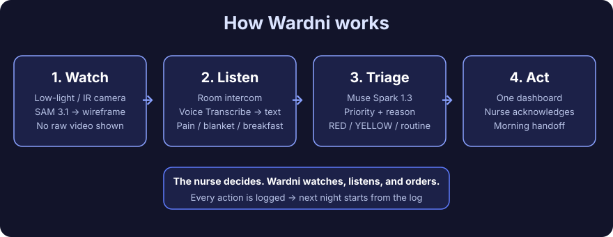
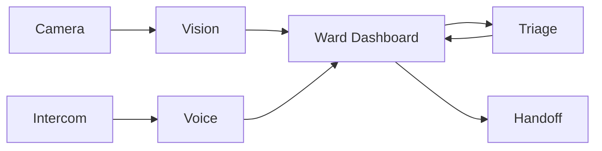

# Wardni

> An AI agent that runs the hospital night shift — watching every room in low light, listening to patients, and telling the nurse what is urgent first. Vision alerts, voice requests, triage order, and morning handoff in one dashboard.

**Night-shift Ward Command Center — one nurse, one dashboard, a whole ward at night.**

  

---

## How it works

1. **Watch.** Low-light cameras in each room. Vision reads patient position and lines, shown as a wireframe, not raw video.
2. **Listen.** Patients speak on the room intercom. Speech is transcribed and tagged by intent.
3. **Triage.** The system orders the work by priority, with a reason, so the nurse knows what to do first.
4. **Act and hand over.** The nurse acts on the ordered list, and the night's events are compiled into a morning handoff.

Full diagrams: [`docs/ARCHITECTURE.md`](docs/ARCHITECTURE.md).

---

## Models

Planned Meta models, to be wired in as the project is built:

- **SAM 3.1** — vision
- **Muse Voice Transcribe** — voice
- **Muse Spark 1.3** — triage and handoff

Details for each model will be added here once they are tested and confirmed, not before.

---

## Status

Documentation first. The project is in development, and this README will be updated as the dashboard, models, and demo are built and verified.

Demo script (draft): [`docs/DEMO-SCRIPT.md`](docs/DEMO-SCRIPT.md).

---

## Safety and privacy

- Raw video is never shown. The nurse view is a wireframe.
- Demo patients are fictional. No real hospital, no real patient data.
- This is a prototype, not a clinical device and not a replacement for nurses.

---

## License

MIT.
