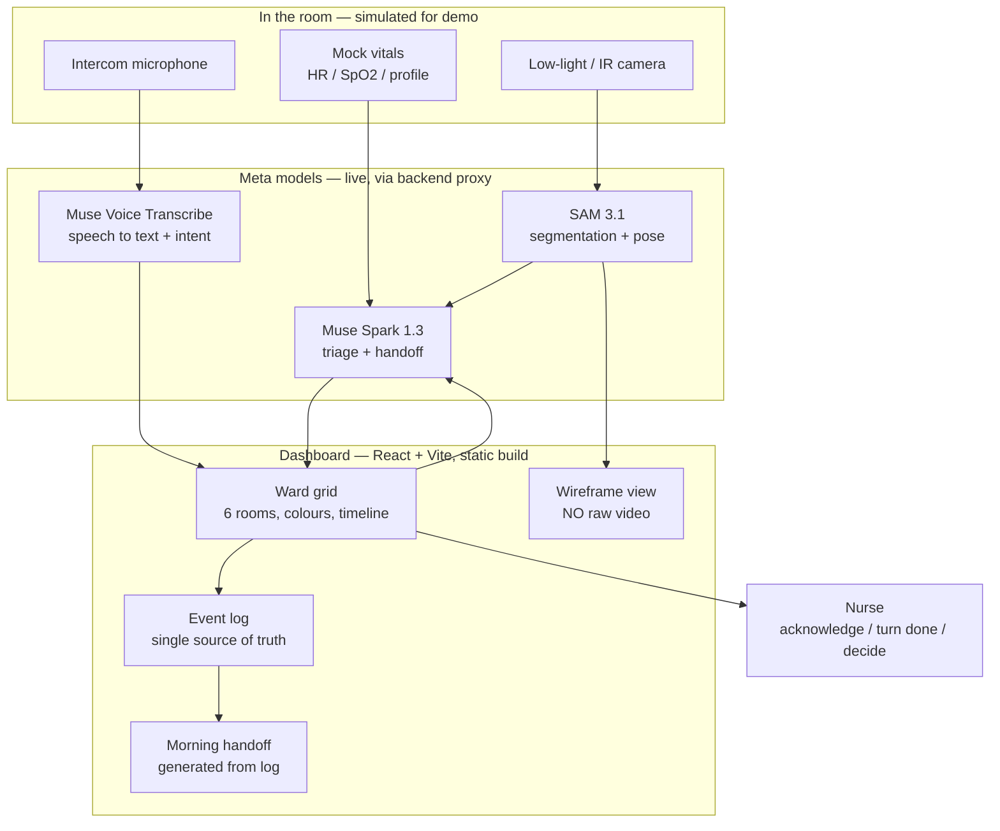
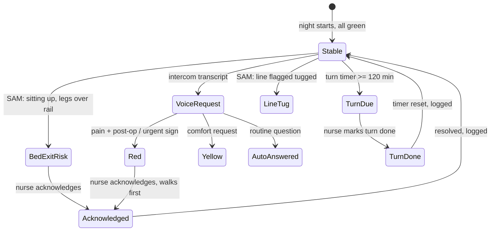
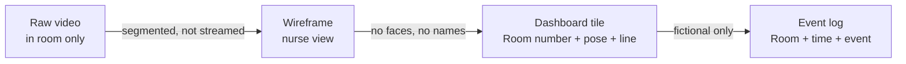

# Architecture — detailed graphs

## System graph



## Adapter interfaces — same shape, simulated and live

Every adapter has `MODE = 'simulated' | 'live'`. Same input, same output, so the
dashboard works with no key, and falls back to simulated if a live call fails.

```js
// src/ai/vision.js
detectVision(room, frame) // -> { pose: 'lying'|'legs-over-rail'|'sitting', line: 'secure'|'tugged', event: null | {type, priority} }

// src/ai/voice.js
transcribe(audio) // -> { text: string, intent: 'pain'|'comfort'|'routine'|'other' }

// src/ai/reasoning.js
triage(request, profile, vitals) // -> { priority: 'RED'|'YELLOW'|'GREEN', reason: string, nextAction: string }
makeHandoff(log) // -> string
```

## Night flow — state graph



## Privacy graph



No raw video, no real names, no real patient data leave the simulated room.
